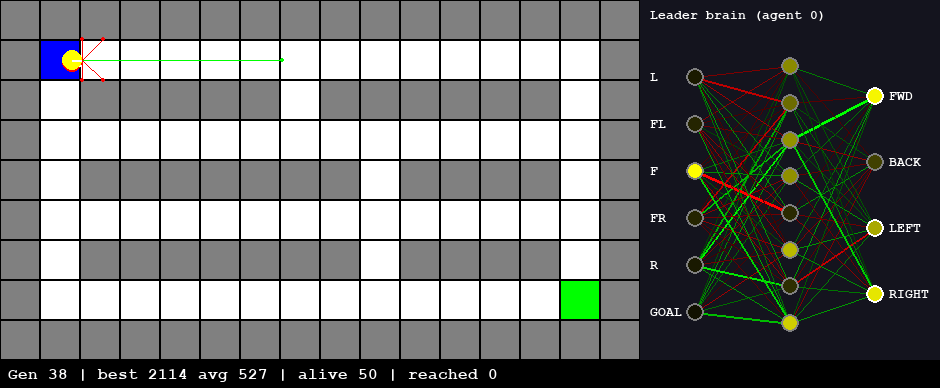
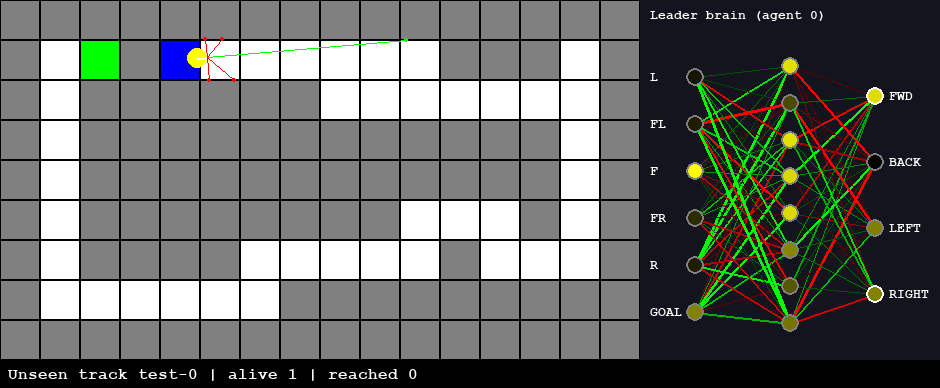

# Neuroevolution Maze Solver

Agents with small neural-network brains learn to drive through a maze. Nobody
programs the route and there's no backpropagation: a genetic algorithm breeds
the networks, and over generations they work out how to reach the goal.

Everything is written from scratch in Python. The neural network, the genetic
algorithm and the simulation use only the standard library. Pygame is used for
drawing.



*Seed 0, generation 38: the first generation in which an agent reaches the
goal. The yellow agent is the current leader. The panel on the right is its
brain, live: inputs on the left, hidden neurons in the middle, actions on the
right. Green and red lines are positive and negative weights, and glowing
neurons are firing.*

## Quick start

```bash
pip install -r requirements.txt
python main.py                 # watch evolution in a window
```

| Command | What it does |
|---|---|
| `python main.py --generations 50` | Evolve with the window (D toggles the debug overlay) |
| `python main.py --headless --csv stats.csv` | Run without a window, as fast as possible, and save per-generation stats |
| `python main.py --seed 3` | Use a different random seed (runs with the same seed are identical) |
| `python main.py --fresh` | Ignore the saved brain and start from random ones |
| `python benchmark.py --seeds 10` | Measure how many generations it takes to solve, over many seeds |
| `python main.py --train-mazes 5 --brain my_driver.json` | Train on 5 new random race tracks every generation (add `--kind maze` for dead-end mazes) |
| `python main.py --test 50 --brain brains/track_driver.json` | Drive a saved brain on 50 tracks it has never seen, with no evolution, and count completed laps |
| `python -m pytest` | Run the tests |

**Saved brain.** The best brain is written to `best_brain.json` after every
generation that improves it, so closing the window never loses training. The
next `python main.py` continues from it automatically. The file is
git-ignored, so a fresh clone always starts from random brains.

## How it works

```
sensors (6) ──► neural network 6-8-4 ──► actions ──► move in maze
     ▲                                                    │
     └────────────────────────────────────────────────────┘
          after the generation: fitness ──► selection ──► crossover + mutation
```

**Sensing.** Each agent casts 5 rays (left, front-left, front, front-right,
right) and reads the distance to the nearest wall, scaled to 0..1. A 6th
input gives the direction to the goal relative to the agent's heading.

**Brain.** A feedforward network: 6 inputs, 8 sigmoid hidden neurons and 4
sigmoid outputs (forward, backward, left, right). An output above 0.5 performs
its action. The network has 92 weights and biases in total, and that list of
92 numbers is the agent's **genome**.

**Fitness** (`evolution/fitness.py`):

```
fitness = path distance closed toward the goal
        + 1000 bonus for reaching the goal
        + up to 500 more the faster it got there
```

Distance is the **BFS shortest path through the corridors**, computed once from
the goal, not the straight-line distance. Straight-line distance would reward
an agent pressed against a wall that happens to be near the goal. An agent is
stopped when it reaches the goal, when it hasn't got closer for 150 frames
(crashed or wandering), or at 1000 frames.

**Genetic algorithm** (`evolution/`), with a population of 50:
1. **Elitism**: the 2 best genomes are copied unchanged into the next
   generation, so the best solution is never lost.
2. **Tournament selection**: pick 3 random genomes, and the fittest becomes a
   parent.
3. **Single-point crossover**: the child takes the first part of its genes
   from parent A and the rest from parent B.
4. **Gaussian mutation**: each gene has a 10% chance of getting noise drawn
   from N(0, 0.5).

## Results

All numbers below come from real runs: `python benchmark.py --seeds 10
--max-generations 100`, population 50, seeds 0–9. The "first solve" is the
first generation in which any agent reaches the goal.

**Final version: solved on 9 of 10 seeds. Median 31 generations to first solve (min 23, max 63).**

| Seed | 0 | 1 | 2 | 3 | 4 | 5 | 6 | 7 | 8 | 9 |
|---|---|---|---|---|---|---|---|---|---|---|
| First solve (generation) | 38 | 63 | 39 | 28 | 29 | 35 | not within 100 | 31 | 23 | 31 |

Learning curve for seed 0 (`python main.py --headless --generations 50 --seed 0`):

| Generation | 1 | 10 | 22 | 37 | 38 | 44 | 50 |
|---|---|---|---|---|---|---|---|
| Best fitness | 520 | 520 | 640 | 720 | 2113.5 | 2114.5 | 2114.5 |
| Average fitness | 80 | 420 | 452.8 | 500.8 | 527.1 | 624 | 670.4 |
| Agents reaching goal (of 50) | 0 | 0 | 0 | 0 | 1 | 5 | 6 |

### What fixed it: the stuck-in-the-corner problem

The first version solved only **4 of 10** seeds. On the failing seeds I
inspected (1 and 3), 40–52% of the population ended exactly in the
top-right corner, 6 cells from the goal, and most of the rest within a few
cells of it. Getting past it needs a 90° turn, and fitness gives no
reward until the agent actually moves down the next corridor. That's a classic
deceptive local optimum.

Two things worked against the agents. A fitness penalty for every move
blocked by a wall pushed them to **stop** in front of walls instead of
turning against them. And with only wall sensors, nothing told them which
way to turn. Each fix was measured over the same 10 seeds × 100 generations:

| Variant | Seeds solved | Median first solve |
|---|---|---|
| Baseline (crash penalty, wall sensors only) | 4/10 | 43.5 |
| Mutation strength 0.2 | 2/10 | 44 |
| Population 100 | 4/10 | 64 |
| Mutation rate 0.2 | 4/10 | 54 |
| Mutation rate 0.05 | 7/10 | 56 |
| No crash penalty only | 3/10 | 49 |
| Goal-direction input only | 4/10 | 36.5 |
| **No crash penalty + goal-direction input (final)** | **9/10** | **31** |

Tuning the GA didn't solve it, and neither change worked on its own (3/10
and 4/10). Only together did they get to 9/10: the agents need both a reason
to keep moving into the corner *and* a cue for which way to turn.

### Limitations, honestly

- These results are for **one fixed maze**. The agents learn a driving reflex
  for this maze, not general maze solving. See the next section for what
  happens on layouts they've never seen.
- The brain is purely reactive and has no memory, so it can't plan a route.
  It reacts to what its sensors see right now.
- Even after solving, only a few agents per generation reach the goal (6/50
  at generation 50 on seed 0), because mutation keeps disrupting the
  children of the winners.
- Seed 6 didn't solve within 100 generations.

## Generalisation to unseen tracks (work in progress)

The goal: a brain that drives *any* track, not just the one it trained on.



*`brains/track_driver.json` completing a lap of unseen test track `test-0`.*

**Setup.** `environment/maze_generator.py` builds random layouts.
- **Race tracks:** a closed loop of road with curves and no dead ends. A wall
  between S and G acts as a finish line, so reaching G means a full lap, and
  the same BFS fitness measures lap progress.
- **Mazes:** "perfect" mazes, meaning there's exactly one path between any
  two cells, full of dead ends.

Training follows the usual machine-learning split:

| Split | Layouts | Used for |
|---|---|---|
| Train | 5 **new** random layouts every generation | fitness = average over them |
| Validation | 10 fixed layouts | choosing which brain to save |
| Test | 50 fixed layouts, never used in training | the numbers below |

Random layouts get a 2000-frame limit. A hand-written driver needs 590–880
frames for one lap.

**Results** (population 50, 100 generations):

| Brain | Unseen mazes solved | Unseen tracks lapped |
|---|---|---|
| Trained on the original maze only (seed 0) | 0 / 50 | 0 / 50 |
| Trained on random mazes (seeds 0, 1, 2) | 0 / 50 each | – |
| Trained on random tracks, seed 1 (`brains/track_driver.json`) | – | **26 / 50** |
| Trained on random tracks, seeds 0, 2, 3, 4 | – | 0 / 50 each |

What this shows:
- **A brain trained on one maze overfits completely.** It solves its own maze
  but nothing else.
- **Training on varied tracks can generalise.** The seed-1 brain completes
  laps on 52% of tracks it has never seen.
- **But it's unreliable: 1 of 5 runs.** In the other four, no car finished a
  lap within 100 generations. The populations stall about a third of the way
  round, a version of the same corner trap as before. Seed 1 first completed
  laps around generation 75, so longer runs may help, but I haven't measured
  that yet.
- **Dead-end mazes didn't work at all**, not even during training. A
  hand-written right-hand-rule driver does solve 8 of 20 of these mazes under
  the same rules, so the mazes are solvable. Evolution from scratch just never
  found wall-following. Changing the rules (counting "stuck" as no new cell
  visited, scoring the closest point reached, a 3000-frame limit) also gave
  0/50 on all 3 seeds.

A bug worth knowing about: building a network draws random numbers for its
starting weights. So the validation runs at first used up random numbers and
changed the course of evolution. A run with validation and one without were
different experiments. The random state is now saved and restored around
validation.

## Project structure

```
main.py            generation loop + CLI flags
benchmark.py       multi-seed measurement
config.py          every tunable constant
agent/             Agent, Movement, SensorSystem, brains (NN, rule-based, keyboard)
environment/       Maze (grid, collision, goal), Tile, random maze/track generator
brains/            trained brains you can test (track_driver.json)
neural_network/    Neuron, Layer, Network, sigmoid (from scratch)
evolution/         Genome, fitness, mutation, crossover, Population
ui/                Renderer, live brain panel, statistics, debug overlay
tests/             pytest: GA operators, fitness, save/load, generators
docs/              design notes for every module
```

## Future work

- **Make track generalisation reliable**: longer runs, more training tracks
  per generation, or a curriculum that starts with easy tracks, measured over
  more seeds.
- Car-like physics (acceleration, momentum) and lap-time fitness for race
  tracks.
- NEAT (evolving the network's structure too) or a recurrent brain with memory.
